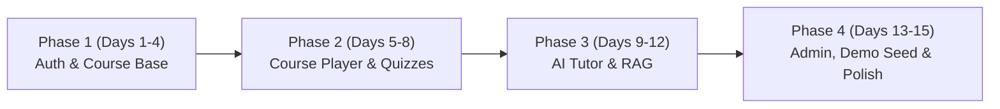

# 15-Day Accelerated Sprint Plan (Nov 16 – Nov 30, 2026)
**Project**: Learning Management System with AI Tutor (LMS-AI)  
**Target Submission Date**: November 30, 2026  
**Total Development Window**: 15 Days (~2 Weeks)

---

## 🎯 Scope Adjustment for 15-Day Timeline

To ensure an end-to-end demoable product by November 30, we fast-track **P0 (Must-Have)** and **Core P1 (High Impact)** features while de-scoping/simplifying lower-priority P2 items (such as complex discussion forums and external billing).

---

## 🗓 Day-by-Day Execution Schedule

### Phase 1: Foundation, Auth & Course Management (Days 1–4: Nov 16–19)
- **Day 1 (Mon, Nov 16)**:
  - Database schema migration & pgvector activation.
  - JWT Auth API (Register, Login, Refresh token rotation) + RBAC middleware (`student`, `instructor`, `admin`).
- **Day 2 (Tue, Nov 17)**:
  - Course, Module, and Lecture CRUD APIs.
  - Public course catalog API with category & difficulty search/filter.
- **Day 3 (Wed, Nov 18)**:
  - Frontend Auth views (Login / Register / Role selector).
  - Student Dashboard & Course Catalog UI wired to backend.
- **Day 4 (Thu, Nov 19)**:
  - Instructor Studio UI (Create Course, add Modules, upload materials).
  - Student Enrollment flow (`/courses/:id/enroll`).

---

### Phase 2: Learning Loop, Progress & Assessments (Days 5–8: Nov 20–23)
- **Day 5 (Fri, Nov 20)**:
  - Course Player UI (video stream, playback speed, resume-from-last-position).
  - Lecture progress tracking API (`/lectures/:id/progress`).
- **Day 6 (Sat, Nov 21)**:
  - Timestamped notes and lecture bookmarking.
  - Assignment creation (Instructor) and file submission (Student).
- **Day 7 (Sun, Nov 22)**:
  - Quiz Engine: MCQ / Multi-select attempt interface.
  - Auto-grading engine & immediate score calculation.
- **Day 8 (Mon, Nov 23)**:
  - Automated PDF Certificate generation upon 100% course completion.
  - Daily active streak counter & user badges.

---

### Phase 3: AI Tutor & RAG Ingestion (Days 9–12: Nov 24–27)
- **Day 9 (Tue, Nov 24)**:
  - AI Service (FastAPI) ingestion pipeline: lecture transcripts chunking & vector embedding generation into PostgreSQL (`pgvector`).
- **Day 10 (Wed, Nov 25)**:
  - RAG Retriever with course-filtered similarity search.
  - AI Tutor Chat UI with source citations (lecture name & timestamp) + explanation depth switcher (Beginner / Intermediate / Advanced).
- **Day 11 (Thu, Nov 26)**:
  - AI Lecture Summarizer (`/ai/lectures/:id/summarize`).
  - AI Flashcard generator for module revision.
- **Day 12 (Fri, Nov 27)**:
  - AI Auto-Quiz generation from transcripts for instructor approval.
  - Personalized study plan generation from student's weak quiz topics.

---

### Phase 4: Admin Console, Polish & Submission (Days 13–15: Nov 28–30)
- **Day 13 (Sat, Nov 28)**:
  - Admin Console: Course approval queue (`approve`/`reject`), user suspension, and platform overview metrics.
- **Day 14 (Sun, Nov 29)**:
  - End-to-end integration pass (Student, Instructor, Admin, AI Tutor).
  - Seed rich demo data (ready-made courses, lectures, quizzes, and transcripts).
  - Docker Compose verification and production build checks.
- **Day 15 (Mon, Nov 30) — SUBMISSION DAY**:
  - Final project package, walkthrough video/demo script, and submission handoff.
