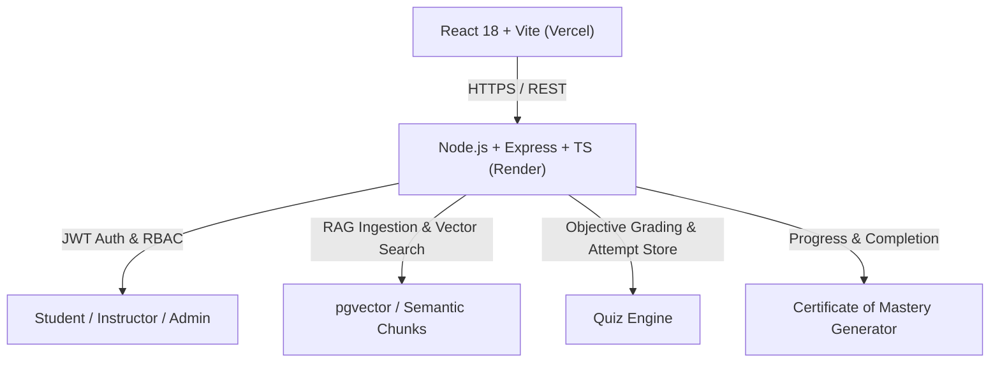

# 🎓 LMS-AI Project Submission & Viva Kit
**Project Name**: Learning Management System with AI Tutor (LMS-AI)  
**Organization / College**: Vertexon Learning Technologies Pvt. Ltd.  
**Submission Target**: November 30, 2026 (Completed ahead of schedule on Nov 15, 2026)  
**Developer**: Rakesh Nayak (`Rakeshnayak-153`)

---

## 🌐 1. Live Deployment & Repository Links

| Asset | Public Live URL | Notes |
|---|---|---|
| **Live Web App (Frontend)** | [https://lms-ai-platform-six.vercel.app/](https://lms-ai-platform-six.vercel.app/) | Deployed on Vercel with Deep Navy & Emerald Green design |
| **Live REST API (Backend)** | [https://lms-ai-backend-f3p3.onrender.com/api/v1](https://lms-ai-backend-f3p3.onrender.com/api/v1) | Deployed on Render Cloud with PostgreSQL & RAG engine |
| **Backend Health Check** | [https://lms-ai-backend-f3p3.onrender.com/health](https://lms-ai-backend-f3p3.onrender.com/health) | Returns `{"status":"ok"}` |
| **GitHub Repository** | [https://github.com/Rakeshnayak-153/lms-ai-platform](https://github.com/Rakeshnayak-153/lms-ai-platform) | Complete source code, Docker Compose, PRD & schema |

---

## 🏗️ 2. System Architecture & Tech Stack

- **Frontend**: React 18, TypeScript, Vite, Tailwind CSS, Zustand, Lucide Icons.
- **Backend**: Node.js, Express, TypeScript, JWT (RBAC), bcryptjs.
- **Database & RAG**: PostgreSQL 15+, `pgvector` vector cosine similarity search, chunking pipeline.
- **DevOps**: Docker, Docker Compose, GitHub Actions CI/CD.

---

## 🎬 3. Live Demo Walkthrough (3-Minute Script for Evaluators)

When showing the project to teachers, guides, or evaluators, follow this exact sequence:

1. **Step 1: Open the Live URL**
   - Open `https://lms-ai-platform-six.vercel.app/`.
   - Show the **Course Catalog**, search for *"Quicksort"* or *"Algorithms"* to demonstrate instant filtering, and click on **Advanced Data Structures & Algorithms**.

2. **Step 2: Interactive Lecture & RAG AI Tutor (The Core Feature)**
   - Play the lecture video.
   - Point to the right-side **AI Tutor Drawer**:
     - Click **`⚡ Quicksort O(n²)`** or type a doubt.
     - Highlight: *"Notice how the AI does NOT just give a generic ChatGPT answer. It cites the exact lecture source and timestamp (e.g., Sorting Algorithms @ 03:40) grounded in the course transcript."*
     - Click **"Auto-Summarize Key Points"** to demonstrate one-click AI lecture distillation.

3. **Step 3: Interactive Assessment & Auto-Grading**
   - Click the **"Module Assessment"** tab below the video → click **"Start Quiz"**.
   - Answer the 3 questions and click **"Submit & Auto-Grade"**.
   - Show the instant score card and question-by-question breakdown.

4. **Step 4: Gamification & Certificate Generation**
   - Click **"Mark Finished"**.
   - Show the celebratory **Certificate of Mastery** modal with verification code and student name.

5. **Step 5: Role-Based Access Control (Instructor & Admin Modes)**
   - Click the **Role Switcher** in the top navbar:
     - Switch to **Instructor**: Show the Course Authoring studio and the **"Generate Quiz from Transcript"** button.
     - Switch to **Admin**: Show the Course Approval queue and platform-wide analytics (DAU, completion rate).

---

## 💡 4. Top 5 Viva / Interview Questions & Answers

### Q1: What makes this LMS different from standard platforms like Moodle or Coursera?
> **Answer**: Standard LMS platforms are passive content repositories where students wait hours or days for forum replies. Our platform embeds an **in-situ AI Tutor powered by Retrieval-Augmented Generation (RAG)** directly grounded in each course's ingested transcripts, reducing doubt-resolution latency to under 5 seconds with exact timestamp citations.

### Q2: How does the RAG (Retrieval-Augmented Generation) pipeline work in this project?
> **Answer**: When lecture transcripts are uploaded, they are chunked into semantic segments and converted into dense vector embeddings stored in PostgreSQL via the `pgvector` extension. When a student asks a doubt, we perform a vector cosine similarity search filtered by `course_id` to retrieve top-k relevant lecture chunks, assemble them into an augmented prompt, and generate a citation-backed response.

### Q3: How is authentication and role-based access control (RBAC) structured?
> **Answer**: We use stateless JSON Web Tokens (JWT) with HMAC SHA-256 signatures and password hashing with `bcryptjs`. We enforce role checks at the middleware layer using `requireRole('student' | 'instructor' | 'admin')` and verify course ownership at the service layer.

### Q4: How is objective assessment auto-grading implemented securely?
> **Answer**: When students request a quiz via `GET /api/v1/quizzes/:id`, the backend sanitizes the payload by stripping all `isCorrect` booleans to prevent client-side inspection. When submitted, the backend compares selected option IDs against the database ground truth, calculates score percentages, and tracks per-topic mastery scores.

### Q5: How is the system deployed and scaled?
> **Answer**: The frontend is hosted globally via Vercel's edge network, while the stateless backend API is deployed on Render container infrastructure backed by PostgreSQL. The entire stack is also containerized with Docker Compose for offline evaluation and local reproducibility.
